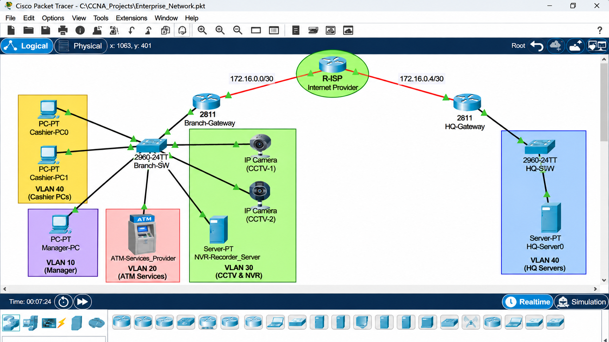

# 🏦 Financial Grade Infrastructure: Local Micro-Bank Sub-Branch & Vault Security

[](https://www.netacad.com/)
[](#)
[](#)

A secure, hardened network implementation for a financial micro-bank branch designed in **Cisco Packet Tracer**. This project focuses on **Central Bank regulatory compliance**, 
strictly enforcing **Layer 2 Switchport Port Security**,
**Isolated ATM transaction pipelines**, and **Extended Outbound/Inbound Access Control Lists (ACLs)**.

---

## 📋 Executive Overview & Threat Model

In micro-banking operations, financial fraud and data exfiltration occur most frequently via rogue hardware insertion at cashier counters or lateral pivot attacks from branch workstations into automated transaction machines (ATMs). 

### Compliance & Security Mandates:
1. **Physical Port Tampering Prevention:** Counter ports must automatically trip to `err-disable` (shutdown) immediately if an unauthorized device is plugged in.
2. **ATM Network Isolation:** The ATM terminal must only communicate with the HQ Core Banking Host on banking ports (`TCP 443 / 8443`). Inter-VLAN reconnaissance and lateral movement from branch workstations must be blocked.
3. **CCTV / Vault Data Confidentiality:** Video feeds from the Vault NVR are restricted strictly within local operations and cannot traverse the WAN edge.

---

## 🗺️ Network Topology & Architecture

- **Security Edge Router:** Cisco 2911 (`Bank-Gateway`)
- **Hardened Access/Distribution Switch:** Cisco 2960-24TT (`Branch-Core-SW`)
- **End-Devices:**
  - Cashier Workstations: `Teller-01`, `Teller-02`
  - Operations Management: `Branch-Manager`
  - Financial Kiosk: `ATM-Kiosk-01`
  - Surveillance Host: `Vault-NVR-Recorder`
  - Remote HQ Core System: `HQ-Core-Banking` (`10.100.100.10/24`)

  
 
### Network Addressing & VLAN Segmentation

| VLAN ID | Name / Segment | Subnet | Gateway | Description |
| :---: | :--- | :--- | :--- | :--- |
| **10** | `Teller-Data` | `192.168.10.0/24` | `192.168.10.1` | Teller Workstations (Teller-01, Teller-02) |
| **20** | `Management` | `192.168.20.0/24` | `192.168.20.1` | Branch Manager Terminal |
| **30** | `ATM-Network` | `192.168.30.0/24` | `192.168.30.1` | ATM Kiosk Transaction Line |
| **40** | `Surveillance` | `192.168.40.0/24` | `192.168.40.1` | Vault NVR & Security Feeds |
| **—** | `WAN-Uplink` | `10.255.0.0/30` | `10.255.0.1` | Point-to-Point Link to HQ Core Banking |

### Interface Allocation Table

| Device | Interface | Mode | Target / Assigned VLAN |
| :--- | :--- | :---: | :--- |
| **Branch-Core-SW** | `Fa0/1 - Fa0/2` | Access | VLAN 10 (`Teller-01 / 02`) |
| **Branch-Core-SW** | `Fa0/3` | Access | VLAN 20 (`Branch-Manager`) |
| **Branch-Core-SW** | `Fa0/4` | Access | VLAN 30 (`ATM-Kiosk-01`) |
| **Branch-Core-SW** | `Fa0/5` | Access | VLAN 40 (`Vault-NVR`) |
| **Branch-Core-SW** | `Gig0/1` | Trunk | Uplink to `Bank-Gateway` (802.1Q) |
| **Bank-Gateway** | `Gig0/1.10 - .40`| Sub-int | Dot1Q Inter-VLAN Routing (ROAS) |
| **Bank-Gateway** | `Gig0/0` | Routed | WAN Connection to `HQ-Core-Banking` |

### 🌐 Network Addressing & VLAN Security Architecture

| Role / Segment | VLAN ID | Subnet / CIDR | Default Gateway | Sub-Interface | Layer 2 Port Security Policy | Access Restrictions |
| :--- | :---: | :--- | :--- | :---: | :--- | :--- |
| **Cashier / Tellers** | `10` | `172.20.10.0/24` | `172.20.10.1` | `Gi0/1.10` | Sticky MAC (Max 1), Violation: `shutdown` | Standard Branch Data |
| **Branch Management** | `20` | `172.20.20.0/24` | `172.20.20.1` | `Gi0/1.20` | Sticky MAC (Max 2), Violation: `restrict` | Management & Monitoring Access |
| **ATM Machine** | `30` | `172.20.30.0/24` | `172.20.30.1` | `Gi0/1.30` | Sticky MAC (Max 1), Violation: `shutdown` | Isolated; Routed exclusively to HQ Core |
| **Vault CCTV / NVR** | `40` | `172.20.40.0/24` | `172.20.40.1` | `Gi0/1.40` | Sticky MAC (Max 1), Violation: `shutdown` | Local view only; Zero WAN outbound |
| **HQ Leased Line (WAN)**| `—` | `10.255.0.0/30` | `10.255.0.1` | `Gi0/0` | Port Security N/A (Routed Port) | Point-to-Point WAN Transit Link |


## ⚙️ Configuration Snippets

### 1. Hardened Switchport Security (Branch-Core-SW)
```cisco
! Cashier Port Hardening (VLAN 10)
interface range FastEthernet0/1 - 2
 switchport mode access
 switchport access vlan 10
 switchport port-security
 switchport port-security maximum 1
 switchport port-security mac-address sticky
 switchport port-security violation shutdown
 spanning-tree portfast
 spanning-tree bpduguard enable
!
! Management Port Hardening (VLAN 20)
interface FastEthernet0/3
 switchport mode access
 switchport access vlan 20
 switchport port-security
 switchport port-security maximum 2
 switchport port-security mac-address sticky
 switchport port-security violation restrict


```
### 2. Router-on-a-Stick & Sub-Interfaces (Bank-Gateway)
```
interface GigabitEthernet0/0
 no shutdown
!
interface GigabitEthernet0/0.10
 encapsulation dot1Q 10
 ip address 172.20.10.1 255.255.255.0
!
interface GigabitEthernet0/0.20
 encapsulation dot1Q 20
 ip address 172.20.20.1 255.255.255.0
!
interface GigabitEthernet0/0.30
 encapsulation dot1Q 30
 ip address 172.20.30.1 255.255.255.0
!
interface GigabitEthernet0/0.40
 encapsulation dot1Q 40
 ip address 172.20.40.1 255.255.255.0
```
 ### 3. Extended Access Control Lists (ACL Enforcement)
```
 ! Strict ATM Pipeline Filtering (Applied inbound on VLAN 30 sub-interface)
ip access-list extended ATM_ISOLATION_ACL
 permit tcp 172.20.30.0 0.0.0.255 host 10.100.100.10 eq 443
 permit tcp 172.20.30.0 0.0.0.255 host 10.100.100.10 eq 8443
 deny ip 172.20.30.0 0.0.0.255 172.20.0.0 0.0.255.255
 deny ip any any log
!
! Vault CCTV WAN Leak Prevention (Applied outbound on WAN interface)
ip access-list extended WAN_EGRESS_FILTER
 deny ip 172.20.40.0 0.0.0.255 any
 permit ip 172.20.10.0 0.0.0.255 any
 permit ip 172.20.20.0 0.0.0.255 any
 permit ip 172.20.30.0 0.0.0.255 any
!
! Applying ACLs
interface GigabitEthernet0/0.30
 ip access-group ATM_ISOLATION_ACL in
!
interface GigabitEthernet0/1  ! WAN Interface to HQ
 ip access-group WAN_EGRESS_FILTER out
```
## 🧪 Verification & Audit Validation

| Test Case | Scenario / Execution | Expected Result | Status |
| :---: | :--- | :--- | :---: |
| **TC-01** | Connect rogue PC to Teller switchport `Fa0/1` | Port trips immediately to `err-disable` state | Passed ✅ |
| **TC-02** | Ping ATM (`172.20.30.10`) from `Teller-01` / `Branch-Manager` | Destination Unreachable / Dropped by ACL | Passed ✅ |
| **TC-03** | Initiate TCP `443` connection from `ATM-Kiosk-01` to `HQ-Core-Banking` | Connection Established | Passed ✅ |
| **TC-04** | Route traffic from `Vault-NVR-Recorder` toward WAN Edge (`10.255.0.2`) | Explicitly dropped by `WAN_EGRESS_FILTER` | Passed ✅ |
